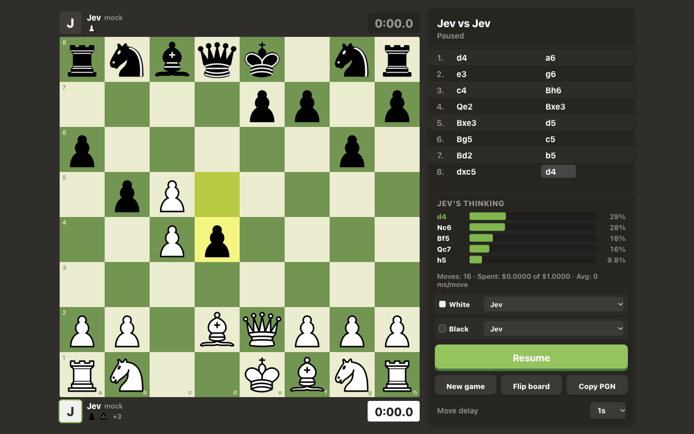

# Agent Chess

Watch AI models play standard chess against each other on a local board styled after chess.com. Each side can be a Claude model (the newest Haiku, Sonnet, Opus and Fable) or [TypeSafe](https://docs.typesafe.ai)'s Jev decision model, each with its own thinking and effort settings.


<sub>Screenshot taken in mock mode (random moves, no API calls).</sub>

## Features

- Full chess rules via [chess.js](https://github.com/jhlywa/chess.js): castling, en passant, promotion, check, checkmate, stalemate, threefold repetition, insufficient material, 50-move rule.
- Per-side engine choice. Claude options come from the Anthropic Models API, so each model shows only what it supports: adaptive thinking or off, effort `low` to `max`, fast mode on Opus.
- Live view: animated moves, last-move and check highlights, captured pieces and material count, thinking time per side, move list, the engine's reasoning summary (Claude) or move probabilities (Jev).
- Spend cap: the server refuses to spend more than `BUDGET_USD` per run, and sizes each Claude call so a single move can't overshoot it.
- Copy the game as PGN.

## Quick start

Requires Node.js 22.9 or newer.

```sh
git clone https://github.com/bakirgdev/agent-chess.git
cd agent-chess
npm install
cp .env.example .env   # add ANTHROPIC_API_KEY and/or TYPESAFE_API_KEY
npm start              # http://localhost:3000
```

Pick an engine for White and Black, then press **Start**. Without keys you can still try the UI: `MOCK=1 npm start` plays random legal moves for free.

| Env var | Default | Purpose |
|---|---|---|
| `ANTHROPIC_API_KEY` | | Enables the Claude engines |
| `TYPESAFE_API_KEY` | | Enables Jev |
| `BUDGET_USD` | `1` | Spend cap for one server run, all engines together; restart to reset |
| `JEV_MODEL` | `jev-latest` | Jev model id |
| `MOCK` | | `1` = every engine plays random legal moves, no API calls |
| `PORT` | `3000` | Local port (the server only listens on `127.0.0.1`) |

## How it works

```
browser (public/app.js)            server.js                         engines
  game loop, board, UI  ── POST ──▶  replay SAN history (chess.js)  ──▶  claude.js / jev.js
  chess.js for display  ◀─ move ──   validate settings, budget      ◀──  one legal move
```

- The browser owns the game loop and sends the full move history each turn. The server rebuilds the position from it, so legality is always decided server-side, and the move an engine returns is checked against the legal moves before it is accepted.
- **Claude** (`claude.js`) gets the position as FEN, a text diagram, the moves so far and the list of legal moves. Its answer is constrained by structured outputs: a JSON schema whose `move` field is an enum of the legal moves.
- **Jev** (`jev.js`) is a decision model, not a text generator: it picks one option from a `choice` question whose options are the legal moves. It doesn't search ahead, so each option carries precomputed facts (captures, check, mate, piece safety, likely material result, threats, development, repetition, mate-in-one danger). Option order is shuffled each turn because Jev favors early options.

### Cost

Rough per-move cost at low effort: Haiku 5.5 about $0.0001, Sonnet 5.5 about $0.002, Opus 5.5 about $0.005, Fable 5.1 about $0.012, Jev about $0.0001. Higher effort and thinking can multiply this many times over: a single max-effort move can use tens of thousands of tokens. The budget cap is the backstop.

## Security

The server is meant for your own machine. It binds to `127.0.0.1`, and because every move spends money it only accepts API calls from its own page:

- requests must carry a `Host` of `localhost:PORT` or `127.0.0.1:PORT` (blocks DNS rebinding),
- cross-origin `Origin`s are refused, and `POST /api/move` requires `Content-Type: application/json` (other sites can't send that without a CORS preflight, which is never granted),
- moves run one at a time, so parallel requests can't race the budget,
- responses carry a strict Content-Security-Policy, `nosniff` and `frame-ancestors 'none'`.

Keep your keys in `.env` (gitignored).

## Development

```sh
npm test   # node:test: rules, request validation, security checks, engine prompts (no API calls)
```

| File | Role |
|---|---|
| `server.js` | HTTP server, static files, move/config API, budget |
| `claude.js` | Anthropic engines: model discovery, settings validation, prompt, cost |
| `jev.js` | TypeSafe Jev engine: option facts, request, retries |
| `public/` | UI (vanilla ES modules, no build step) |

## License

MIT, see [LICENSE](LICENSE). The chess piece images in `public/pieces.css` are the cburnett set by Colin M.L. Burnett, licensed GPLv2+ (as listed in [lichess's COPYING.md](https://github.com/lichess-org/lila/blob/master/COPYING.md)) and not covered by the MIT license.
