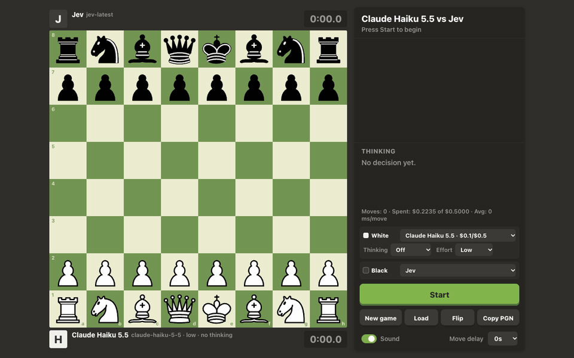

# Agent Chess

Watch AI models play standard chess against each other on a local board styled after chess.com, or play them yourself. Each side can be a Claude model (the newest Haiku, Sonnet, Opus and Fable), [TypeSafe](https://docs.typesafe.ai)'s Jev decision model, or a human, and each engine has its own thinking and effort settings.


<sub>A complete real game (real API calls, $0.0065): Claude Haiku 5.5 at low effort with thinking off (White) vs Jev (Black), graded live by native Stockfish. One frame per move; Jev mates on move 34.</sub>

## Features

- Full chess rules via [chess.js](https://github.com/jhlywa/chess.js): castling, en passant, promotion, check, checkmate, stalemate, threefold repetition, insufficient material, 50-move rule.
- Per-side engine choice. Claude options come from the Anthropic Models API, so each model shows only what it supports: adaptive thinking or off, effort `low` to `max`, fast mode on Opus.
- Play yourself: pick **Human** for either side, then click or drag pieces (legal-move dots, promotion picker) or type the move (`Nf3`, `e8=Q`, `g1f3`). Human vs human works too.
- Live view: animated moves, last-move and check highlights, captured pieces and material count, thinking time per side, move list, the engine's reasoning summary (Claude) or move probabilities (Jev), and move sounds (with a switch).
- Eval bar and move grades like chess.com's game review: every move is marked Forced, Great, Best, Excellent, Good, Inaccuracy, Mistake or Blunder, with an approximate accuracy per side. Pick the engine under **Eval**: *Browser* runs Stockfish 19 lite (WASM, 1.8 MB) in a worker, with nothing to install; *Native* uses the Stockfish installed on your machine (`brew install stockfish`), which is stronger and faster.
- Browse the game: click any move, or use ←/→, Home and End, while the game keeps going.
- Start from any position: paste a FEN or a PGN, and the game continues from its last position.
- Spend cap: the server refuses to spend more than `BUDGET_USD` per run, and sizes each Claude call so a single move can't overshoot it.
- Copy the game as PGN (with the `FEN` header when it started from a custom position).

## Quick start

Requires Node.js 22.9 or newer.

```sh
git clone https://github.com/bakirgdev/agent-chess.git
cd agent-chess
npm install
cp .env.example .env   # add ANTHROPIC_API_KEY and/or TYPESAFE_API_KEY
npm start              # http://localhost:3000
```

Pick an engine (or Human) for White and Black, then press **Start**. Without keys you can still try the UI: `MOCK=1 npm start` makes every engine play random legal moves for free, and Human play needs no key at all.

| Env var | Default | Purpose |
|---|---|---|
| `ANTHROPIC_API_KEY` | | Enables the Claude engines |
| `TYPESAFE_API_KEY` | | Enables Jev |
| `BUDGET_USD` | `1` | Spend cap for one server run, all engines together; restart to reset |
| `JEV_MODEL` | `jev-latest` | Jev model id |
| `MOCK` | | `1` = every engine plays random legal moves, no API calls |
| `PORT` | `3000` | Local port (the server only listens on `127.0.0.1`) |
| `STOCKFISH_PATH` | `stockfish` | Native Stockfish binary for *Eval: Native*; found on `PATH` by default |

## How it works

```
browser (public/app.js)            server.js                         engines
  game loop, board, UI  ── POST ──▶  replay SAN history (chess.js)  ──▶  claude.js / jev.js
  chess.js for display  ◀─ move ──   validate settings, budget      ◀──  one legal move
```

- The browser owns the game loop and sends the start position (FEN) and the full move history each turn. The server rebuilds the position from them, so legality is always decided server-side, and the move an engine returns is checked against the legal moves before it is accepted. Human moves never reach the server on their own; they arrive in the history of the next engine request.
- **Claude** (`claude.js`) gets the position as FEN, a text diagram, the moves so far and the list of legal moves. Its answer is constrained by structured outputs: a JSON schema whose `move` field is an enum of the legal moves.
- **Analysis** never touches a paid API. Each position gets a short Stockfish search (300 ms native, 400 ms in the browser) for the two best lines. A move's grade comes from the mover's drop in win chance (lichess's centipawn-to-win% curve and thresholds, chess.com's names). It is "Great" when it is the engine's choice and the second-best move is at least 15 points worse.
- **Jev** (`jev.js`) is a decision model, not a text generator: it picks one option from a `choice` question whose options are the legal moves. It doesn't search ahead, so each option carries precomputed facts (captures, check, mate, piece safety, likely material result, threats, development, repetition, mate-in-one danger). Option order is shuffled each turn because Jev favors early options.

### Cost

Measured per-move cost in the opening at low effort: Haiku 5.5 about $0.0001, Sonnet 5.5 about $0.002, Opus 5.5 about $0.004 ($0.007 in fast mode), Fable 5.1 about $0.008, Jev about $0.0001. Higher effort and thinking can multiply this many times over: in our tests a single max-effort Opus 5.5 move in the middlegame used 29,914 output tokens ($0.60). The budget cap is the backstop.

Adaptive thinking decides for itself whether to think. In our tests the opening moves came back without a reasoning summary at low to high effort; `max` effort reliably shows one.

## Security

The server is meant for your own machine. It binds to `127.0.0.1`, and because every move spends money it only accepts API calls from its own page:

- requests must carry a `Host` of `localhost:PORT` or `127.0.0.1:PORT` (blocks DNS rebinding),
- cross-origin `Origin`s are refused, and `POST /api/move` requires `Content-Type: application/json` (other sites can't send that without a CORS preflight, which is never granted),
- moves run one at a time, so parallel requests can't race the budget,
- responses carry a strict Content-Security-Policy, `nosniff` and `frame-ancestors 'none'`.

Keep your keys in `.env` (gitignored).

## Development

```sh
npm test   # node:test: rules, custom start positions, request validation, security checks, engine prompts (no API calls)
```

`CLAUDE.md` lists the invariants to keep (money, legality, security) for anyone changing the code with an AI agent.

| File | Role |
|---|---|
| `server.js` | HTTP server, static files, move/config API, budget |
| `claude.js` | Anthropic engines: model discovery, settings validation, prompt, cost |
| `jev.js` | TypeSafe Jev engine: option facts, request, retries |
| `public/app.js` | UI: game loop, board, human input, move browsing, settings (vanilla ES modules, no build step) |
| `public/sound.js` | Move sounds synthesized with WebAudio |
| `public/uci.js` | UCI client shared by both Stockfish backends |
| `public/chessutil.js` | Helpers shared by server and browser: move numbering, illegal-position check |
| `analysis.js` | Optional native Stockfish process behind `POST /api/eval` |

## License

MIT, see [LICENSE](LICENSE). Exceptions:

- `public/vendor/stockfish/` holds the lite single-threaded build of [Stockfish.js 19.0.1](https://github.com/nmrugg/stockfish.js/releases/tag/v19.0.1), licensed GPLv3 ([COPYING.txt](public/vendor/stockfish/COPYING.txt)); its source is at that link. Native Stockfish is not bundled: you install it yourself.
- The chess piece images in `public/pieces.css` are the cburnett set by Colin M.L. Burnett, licensed GPLv2+ (as listed in [lichess's COPYING.md](https://github.com/lichess-org/lila/blob/master/COPYING.md)) and not covered by the MIT license.
